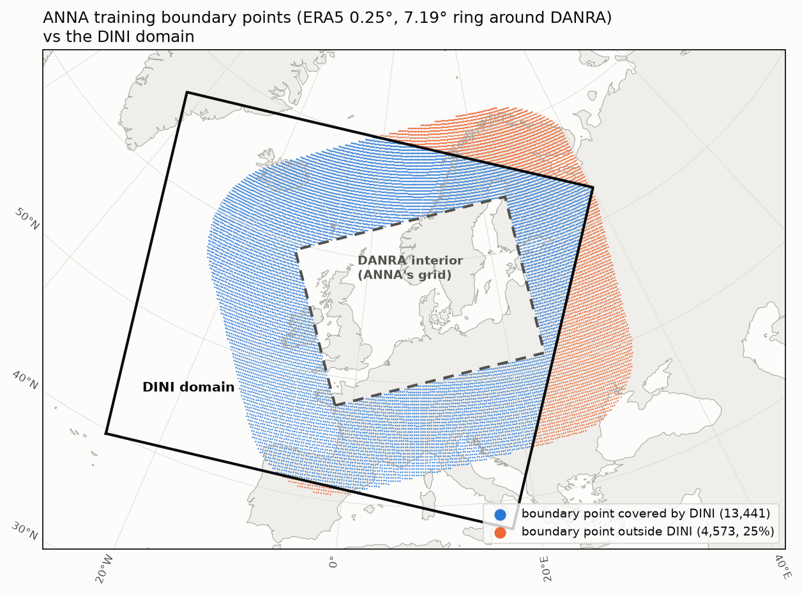

# mlwp-inference-container-anna

This repository builds the inference container images for **ANNA**, which
runs the **DANRA machine-learning limited area model** of Adamov et al.
(2025), ["Building Machine Learning Limited Area Models: Kilometer-Scale
Weather Forecasting in Realistic Settings"](https://arxiv.org/abs/2504.09340)
operationally from **DINI** (interior initial states), with **DINI or IFS** on
the boundary. The model is a hierarchical graph-based model (neural-lam
`hi_lam`, graph `7deg_rect_hi4`) trained on DANRA (2.5 km, 3-hourly) with ERA5
boundary forcing on a 7.19° ring around the DANRA domain.

It holds everything needed for that, in one Python project
([pyproject.toml](pyproject.toml), exact environment in `uv.lock`):
- the inference pipeline (`src/anna_inference/`, run by
  [scripts/entry.sh](scripts/entry.sh), the image's entrypoint);
- the [Containerfile](Containerfile) and
  [scripts/build_image.sh](scripts/build_image.sh);
- the tools that build the model's *inference artifact* (configs, training
  statistics, grids, see below; `src/anna_inference/artifact/`, docs in
  [artifact/](artifact/README.md)).

ANNA was developed in
[mlwm-deployment](https://github.com/leifdenby/mlwm-deployment)
(`configurations/ANNA`) and moved here with its git history. The full
history, decisions and the reasons behind them are in
[HISTORY.md](HISTORY.md). Paths in it refer to the layout in mlwm-deployment
(e.g. `configurations/ANNA/src/regrid_dini.py` is now
`src/anna_inference/regrid_dini.py`, `inference-artifact/` is now
`artifact/` and `src/anna_inference/artifact/`).

## Model

Described in [configs/model.yaml](configs/model.yaml) (checkpoint, graph
recipe, neural-lam arguments), which `entry.sh` and the container build read.

- Checkpoint: the paper's DANRA model, Zenodo
  [10.5281/zenodo.15131838](https://doi.org/10.5281/zenodo.15131838)
  (`danra_model.ckpt`, CC-BY-4.0, by S. Adamov, J. Oskarsson and K. S. Hintz)
- Training: wandb [`jo-research-team/neural_lam/hfzfhiha`](https://wandb.ai/jo-research-team/neural_lam/runs/hfzfhiha)
  (`train-hi_lam-2x300-02_17_19-2867`), a 3-epoch fine-tune with 4-step
  rollouts of `train-hi_lam-2x300-02_13_14-1703`, with
  [`joeloskarsson/neural-lam-dev`](https://github.com/joeloskarsson/neural-lam-dev)
  commit `e7d11c9`
- Run without `--dynamic_time_deltas`: the model was trained before that flag
  existed, and leaving it off reproduces its behaviour

An earlier artifact, `gefion-1`, held an unpublished ablation run (graph
`7deg_rect_hi3`, trained with `--dynamic_time_deltas`), not the paper's model.
It was trained on the same datastores, so it still supplies the training
statistics and grids. See
[artifact/README.md](artifact/README.md#gefion-1-a-prior-incorrect-inference-artifact).

## Software

Pinned in [pyproject.toml](pyproject.toml):

- **neural-lam**: `joeloskarsson/neural-lam-dev@a44d432e` (`research` branch,
  contains the training code and forecast-format boundary forcing, needed for
  IFS; later commits break installing from git)
- **mllam-data-prep**: `sadamov/mllam-data-prep@dd9af481`, the version used
  for training. mllam-data-prep ≥ 0.7 doesn't keep per-point lat/lon for
  regular lat/lon grids, which neural-lam-dev needs for the boundary
- **zarr 2**, as in training; neural-lam-dev writes its output with a zarr v2
  compressor

## Configs

All in [configs/](configs/):

| File | What |
|---|---|
| `model.yaml` | the model to run: checkpoint (Zenodo URL, md5), graph recipe, neural-lam arguments, and which neural-lam config to use per boundary source (`neural_lam_configs`: `era5` as in training, `dini`, `ifs`) |
| `danra_model1_config.yaml` | interior (DANRA) datastore, as in training |
| `era_7deg_model1_config.yaml` | ERA5 boundary datastore the model was trained with; reference for the boundary features and their (ERA5) normalisation statistics |
| `ifs_7deg_model1_config.yaml` | operational IFS boundary. **Its header is the contract for the IFS GRIB → zarr conversion** (variables, units, dims, lead times, and the 0.25° box lat 40.0–72.0, lon −27.0–39.5; the east edge must be exactly 39.5°E) |
| `dini_7deg_model1_config.yaml` | DINI boundary, in the same layout as IFS |
| `7deg_config_{era5,ifs,dini}.yaml` | neural-lam configs; IFS and DINI are normalised with the ERA5 training statistics (`overload_stats_path`) |

The configs are linked in a chain, and each link is stated in one place only:
1. `model.yaml` names the neural-lam config for each boundary source;
2. that neural-lam config names its interior and boundary datastore configs
   (`datastore.config_path`, `datastore_boundary.config_path`);
3. for DINI/IFS, it also names the ERA5 training boundary datastore whose
   statistics normalise the boundary (`overload_stats_path`).

`anna_inference.model_configs` follows this chain for the scripts.

## Inference artifact

An **inference artifact** is a directory (shipped as a zip) that holds
everything needed to run a trained model's forecasts, apart from the input
data and the software (the term comes from
[mlwm-deployment](https://github.com/leifdenby/mlwm-deployment)). It
normally has:
- the model checkpoint (weights);
- the configs the model was trained with (neural-lam and mllam-data-prep
  datastore configs) and its training arguments;
- the training dataset statistics, which inputs are normalised with and
  outputs de-normalised with.

Without the artifact, the checkpoint alone can't be run. The model expects
its inputs in a particular feature order and normalisation, and on a
particular grid and graph, and these only follow from the configs and
statistics it was trained with.

The artifact should be collected on the machine the model was trained on,
where the training datastores are. ANNA's had to be reconstructed after the
fact: the boundary configs, statistics and grid were missing (see
[artifact/README.md](artifact/README.md)). ANNA's artifact has:

| Path | What |
|---|---|
| `configs/` | the configs above, including `model.yaml` |
| `configs/era_7deg_model1_config.zarr` | the ERA5 boundary statistics in the form neural-lam reads them (`overload_stats_path`) |
| `stats/` | training statistics of the DANRA interior and the ERA5 boundary datastores (the ERA5 ones recomputed exactly) |
| `grids/` | the DANRA grid and statics (target grid for regridding DINI) and the 18,014 ERA5 boundary points the model was trained with |
| `artifact.yaml`, `README.md` | provenance and description |
| `danra_model.ckpt` | the checkpoint |

The checkpoint is already public (Zenodo 15131838), so it isn't re-published.
The artifact is therefore published **without the checkpoint**, as the
*inference package* zip on Zenodo (record to be added once published).

The container build puts the two back together:
- it fetches the package, or uses a locally built one;
- it downloads the checkpoint into it (md5-checked);
- the result is the complete artifact at `/workspace/inference_artifact`,
  which `entry.sh` reads (`INFERENCE_ARTIFACT_PATH`).

How the artifact is built, checked and published, and its provenance, are in
[artifact/README.md](artifact/README.md). That includes the superseded
`gefion-1` artifact, which held a different model. The README shipped inside
the package is [artifact/package-README.md](artifact/package-README.md).

## Building the image

```bash
CONTAINER_APP=podman scripts/build_image.sh
```

The image is tagged `mlwp-inference-container-anna:latest` (`ANNA_IMAGE_NAME`).

- `ARTIFACT_SOURCE=local` (default) uses a locally built artifact directory,
  `LOCAL_ARTIFACT_DIR` (default `artifact/build/anna-local`).
- `ARTIFACT_SOURCE=zenodo` downloads the published package (`PACKAGE_URL`,
  `PACKAGE_MD5`).

In both cases the model checkpoint is downloaded from Zenodo during the build
(md5-checked) if it isn't already there. No AWS credentials are needed. Set
`ANNA_PULL_PROXY` to pull the base image through DMI's proxy.

## Running a forecast

[scripts/entry.sh](scripts/entry.sh) runs the whole pipeline:

1. `anna_inference.regrid_dini`: DINI → DANRA grid (interior) and, for the
   DINI boundary, → the 0.25° ERA5 boundary box. Reads DINI concurrently
   with dask
2. `anna_inference.create_inference_dataset`: inference datastores and
   neural-lam config
3. `neural_lam.build_rectangular_graph`: the model's graph (`model.yaml`)
4. `neural_lam.train_model --eval test`: the forecast
5. `anna_inference.convert_output`: DANRA-like output datasets

It's configured through environment variables:

| Variable | Default | |
|---|---|---|
| `ANALYSIS_TIME` | (required) | DINI analysis time, e.g. `2026-10-01T00:00Z`; 00/06/12/18 UTC with the DINI boundary |
| `FORECAST_DURATION` | `PT18H` | multiple of 3 h, between 12 h (neural-lam needs that to load the model) and DINI forecast length − 6 h (30 h for a 36 h DINI run) |
| `BOUNDARY_SOURCE` | `dini` | `dini` or `ifs` |
| `DINI_ROOT` | `s3://harmonie-zarr/dini/control/{analysis}/` | DINI forecast zarrs |
| `IFS_BOUNDARY_PATH` | | IFS forecast zarr, required for `BOUNDARY_SOURCE=ifs` |
| `INFERENCE_WORKDIR` | `./inference_workdir` | |
| `INFERENCE_ARTIFACT_PATH` | `./inference_artifact` | the inference artifact (with checkpoint); outside the container e.g. `artifact/build/<name>` |
| `ANNA_DEBUGGER` | | `ipdb` to debug the python steps on exceptions |
| `SKIP_COMPLETED` | `false` | `true` skips the stages already completed in the workdir (e.g. rerun only the forecast) |

Outside the container, run it in the uv environment of this repository
(`uv sync`), with AWS credentials for reading DINI (e.g. `AWS_PROFILE`):

```bash
INFERENCE_ARTIFACT_PATH=artifact/build/anna-local \
    ANALYSIS_TIME=2026-10-01T00:00Z FORECAST_DURATION=PT18H scripts/entry.sh
```

A 12 h forecast takes about 5 minutes on a DGX Spark (GB10 GPU), and needs
about 28 GB of GPU memory and up to about 6 GB of RAM (regridding, graph).

In the container, with [scripts/run_inference_container.sh](scripts/run_inference_container.sh):

```bash
CONTAINER_APP=docker AWS_PROFILE=... \
    scripts/run_inference_container.sh 2026-10-01T00:00Z PT12H
```

- It mounts `INFERENCE_WORKDIR` (default `./inference_workdir`) for the inputs
  and outputs, and passes the variables above.
- AWS credentials are passed at run time (`AWS_*` variables and `~/.aws`,
  read-only), never built into the image.
- With docker it runs as the calling user, so the outputs are yours.

The image gives the same forecast as the uv environment: identical outputs
for DINI 2026-10-01T00Z PT12H, with the image's NVIDIA torch 2.10.

### Outputs and conventions

`${INFERENCE_WORKDIR}/outputs/single_levels.zarr` (pres_seasurface, t2m, u10m,
v10m, pres0m, lwavr0m, swavr0m) and `pressure_levels.zarr` (z, t, r, u, v, tw
at 100–1000 hPa) are on the DANRA grid at valid times T+6 h …
T+`FORECAST_DURATION` in 3 h steps. The initial states are DINI at T+0 and
T+3 h. The conventions are DANRA's:

- **winds are relative to the DANRA (Lambert) grid**, not east/north
- relative humidity `r` is a fraction (0–1)
- `lwavr0m`/`swavr0m` are net surface radiation fluxes
- `tw` is geometric vertical velocity (m/s)

The grid is described with CF metadata as in the DINI zarrs: `x`/`y` in
metres of the DANRA Lambert projection, 2D `lat`/`lon`, and a
`danra_projection` grid mapping variable named by every field's
`grid_mapping`. Viewers such as Gridlook need it to recognise the grid.

## Known limitations

- **DINI boundary.** 25% of the model's boundary points (4,573 of 18,014) lie
  outside the DINI domain, mostly to the east and north. They are filled with
  the value of the nearest DINI grid point. IFS covers the whole ring and is
  the preferred boundary source once the IFS zarr is available.

  

- **DINI boundary: 00/06/12/18 UTC only.** The model was trained with a
  6-hourly ERA5 boundary at 00/06/12/18 UTC. The boundary is therefore given
  to neural-lam as valid times on that grid, which for each prediction uses
  the last boundary time at or before it ± 6 h. A forecast from, say, 03Z
  needs the boundary at 00Z, which its own DINI run doesn't have. IFS
  boundaries can come from an older cycle (the latest at or before the
  analysis time).

- **DINI zarr retention** is two weeks. Keep regridded development cases
  locally in `dev-data/` (gitignored).

## Development

```bash
uv sync                          # the environment (exact versions in uv.lock)
uv run pre-commit install        # black (79), isort, flake8 on every commit
uv run pytest tests
```

- [artifact/](artifact/README.md): building, checking and publishing the
  inference artifact
- [dev-utils/](dev-utils/):
  - `check_forecast_output.py`: sanity checks of a forecast, against DINI;
  - `check_inference_sample.py`: checks the sample neural-lam builds from
    the inference datastores;
  - `plot_boundary_coverage.py`: the boundary coverage map above.
- Each pipeline step can also be run on its own, e.g.
  `uv run python -m anna_inference.regrid_dini --help`.

## Licence

The code is licensed under the [MIT licence](LICENSE). The published
inference package (configs, statistics, grids) is CC-BY-4.0, and the model
checkpoint (Zenodo 15131838) is CC-BY-4.0 by its authors.
